# LUT 搜索器 · LumixLutSearch

> 浏览、筛选、下载 [LUMIX Lab](https://lumix-base.jpn.panasonic.com/) 社区 LUT 的 Android 工具。
> 官方 App 没有全文检索、不能多维筛选、看不到榜单 —— 这个工具补上这些。

**非官方项目，与 Panasonic 无任何关联。** 数据来自 LUMIX Lab 公开接口，本仓库不打包、不分发任何 LUT 文件。

<p align="center">
  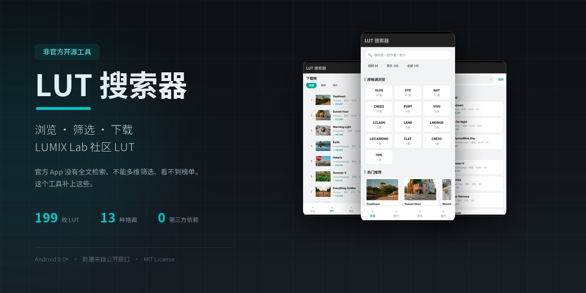
</p>

<p align="center">
  <a href="https://github.com/MangDao/LumixLutSearch/releases/latest">
    
  </a>
  
  
  
</p>

<p align="center">
  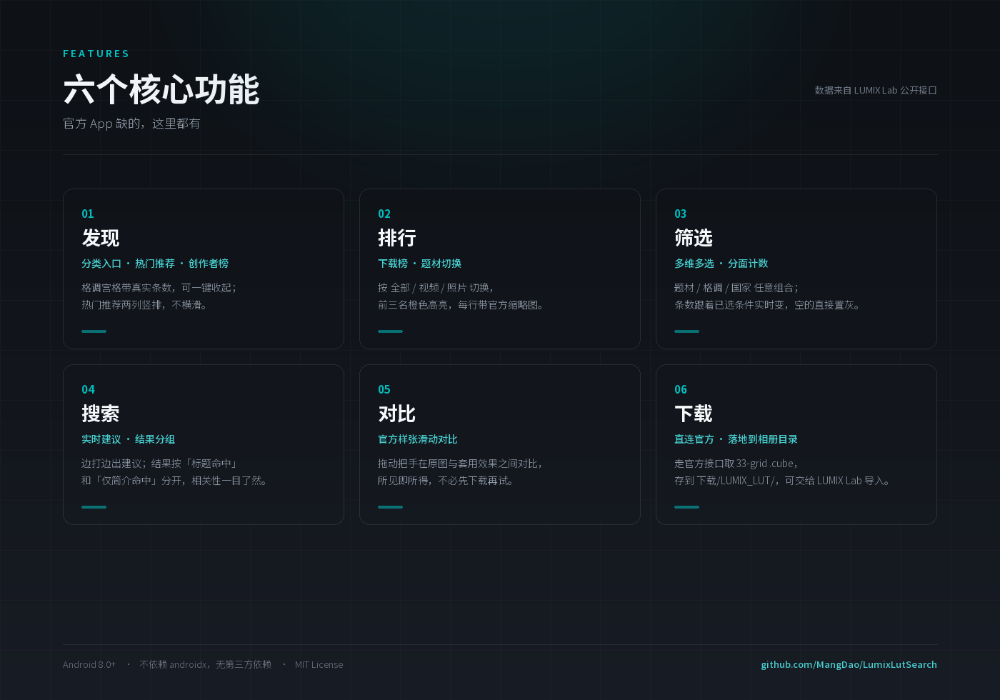
</p>

---

## 功能

<table>
<tr>
<td width="50%" valign="top">
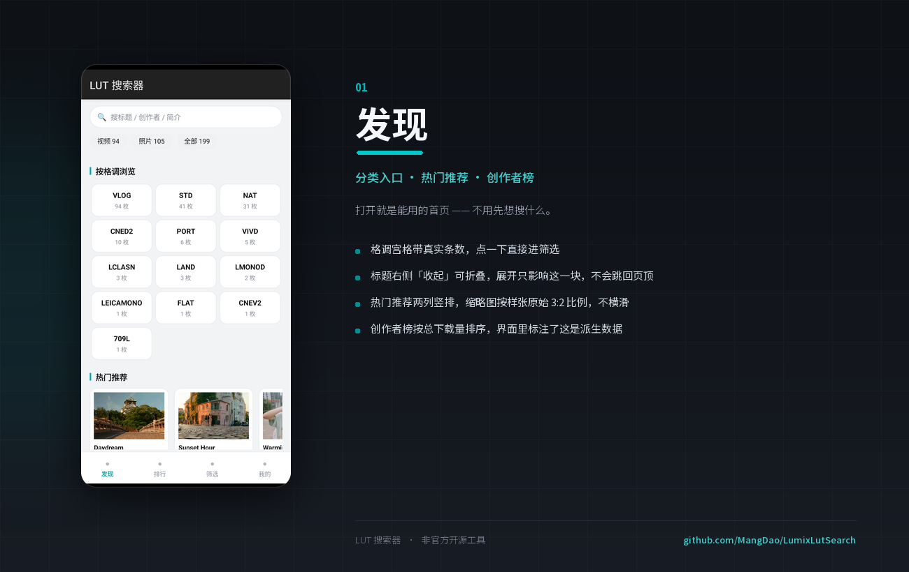
</td>
<td width="50%" valign="top">
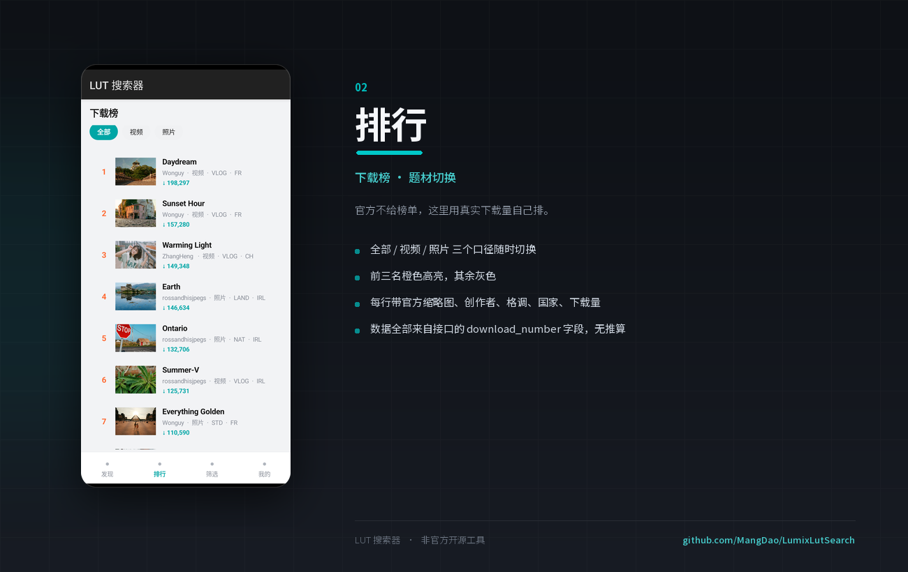
</td>
</tr>
<tr>
<td width="50%" valign="top">
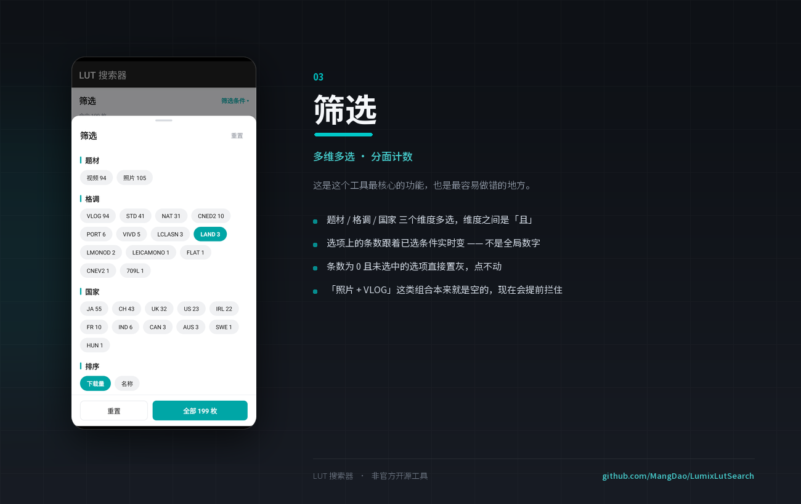
</td>
<td width="50%" valign="top">
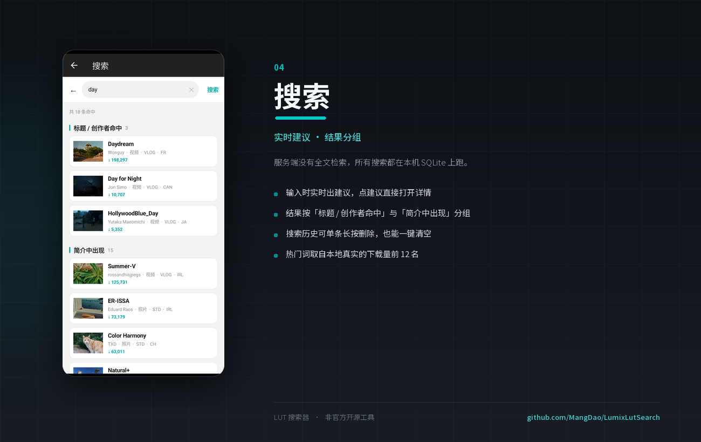
</td>
</tr>
</table>

### 下载安装

直接到 [Releases](https://github.com/MangDao/LumixLutSearch/releases/latest) 下载 APK，
手机上允许「安装未知来源应用」即可。需要 **Android 8.0 及以上**。

### 界面截图

<p align="center">
  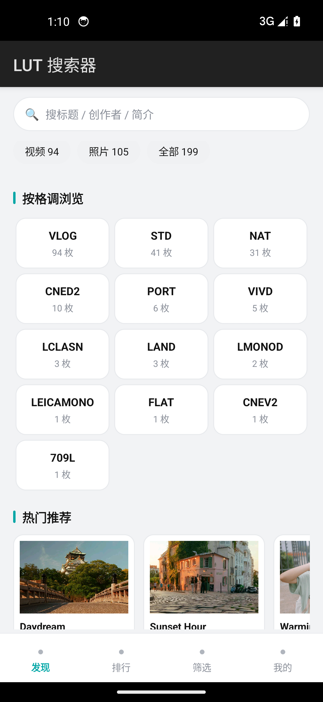
  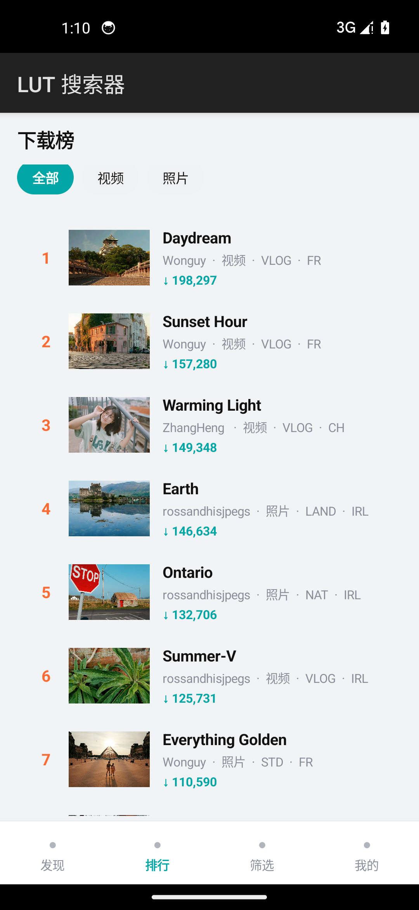
  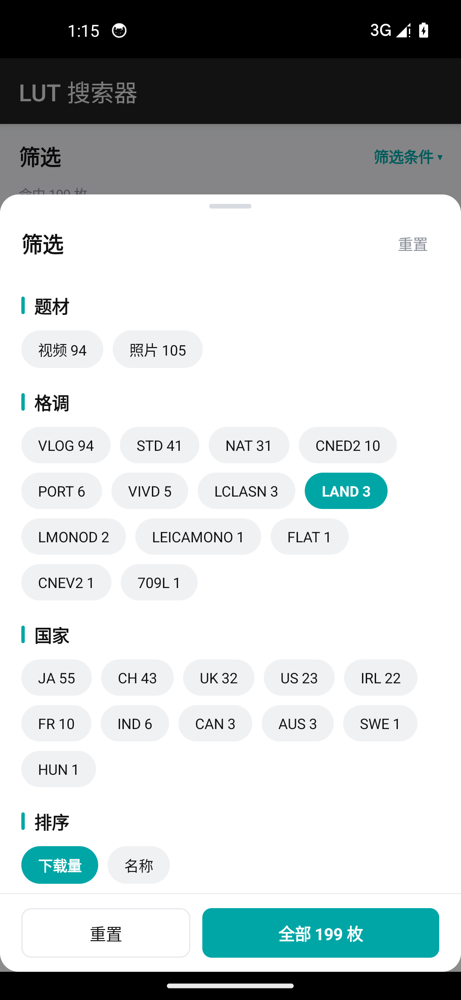
  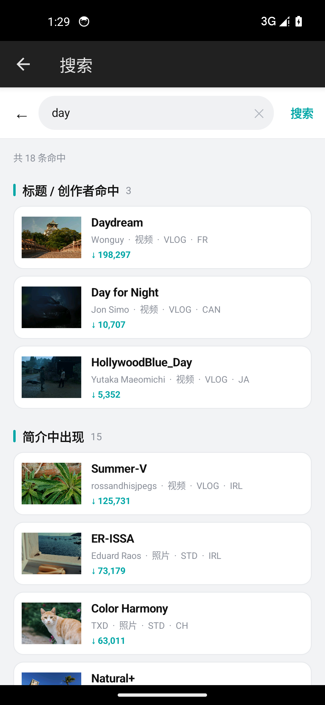
  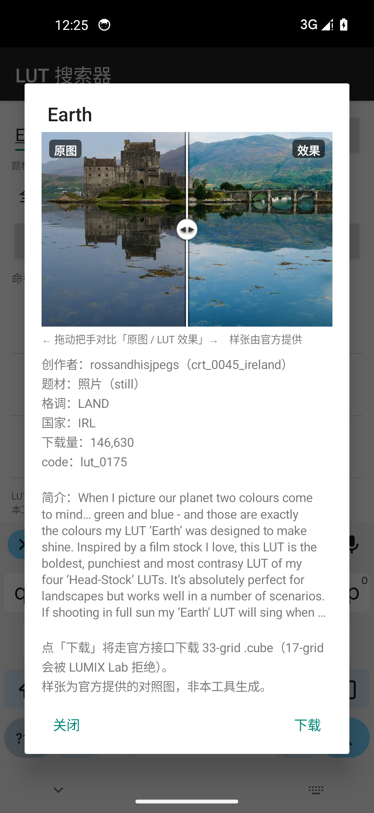
</p>

### 宣传素材（可自由取用）

欢迎拿去转发、写文章、做视频封面。

**横版**（`docs/promo/`，适合桌面 / 网页 / 博客）

| 文件 | 尺寸 |
|---|---|
| `01-封面.png` | 1280×640（GitHub 社交预览尺寸） |
| `02-功能总览.png` | 1400×980 |
| `03-发现.png` · `04-排行.png` · `05-筛选.png` · `06-搜索.png` | 1300×820 |

**竖版**（`docs/promo-vertical/`，适合手机分享）

| 文件 | 尺寸 |
|---|---|
| `竖版-01-封面.png` | 1080×1440 |
| `竖版-02-功能总览.png` | 1080×1660 |
| `竖版-03~06`（发现 / 排行 / 筛选 / 搜索） | 1080×1440 |
| `竖版-07-长图.png` | 1080×5010（一张图讲完全部功能） |

> 竖版统一 **3:4**，朋友圈、小红书、QQ 空间都能整张显示，不会被裁。
> 长图适合一次发完，不用发九宫格。


| | |
|---|---|
| **发现** | 搜索入口 · 快捷题材 chips · 格调分类宫格（可收起）· 热门推荐两列竖排 · 创作者榜 |
| **排行** | 下载榜，按 全部 / 视频 / 照片 切换，前三名高亮，带缩略图 |
| **筛选** | 底部弹层多选。题材 · 格调 · 国家，**分面计数**，排序 |
| **搜索** | 实时建议 · 搜索历史 · 热门词 · **结果分组**（标题/创作者命中 vs 仅简介命中） |
| **对比** | 官方样张滑动对比（原图 ↔ 套用效果） |
| **下载** | 走官方接口取 33-grid `.cube`，落盘到公共 `下载/LUMIX_LUT/` |
| **我的下载** | 已下载列表，打开 / 分享 / 删除记录 |
| **设置** | 自动更新频率（每次打开 / 1·3·5 天 / 1 周 / 手动）· 离线样张缓存开关 |


---

## 构建

需要 **JDK 17** 和 **Android SDK（platform 34 / build-tools 34.0.0）**。

```bash
git clone https://github.com/<你的用户名>/LumixLutSearch.git
cd LumixLutSearch

# 指向你的 SDK（这个文件已被 .gitignore 忽略）
echo "sdk.dir=/path/to/android-sdk" > local.properties

./gradlew assembleDebug
# 产物：app/build/outputs/apk/debug/app-debug.apk
```

Windows 下用 `gradlew.bat`。

**环境说明**：本项目**不依赖 androidx，也没有任何第三方依赖** ——
全部界面用原生 `View` 代码构建。这样做是为了让 APK 尽量小、依赖树干净，
代价是所有控件（含自动换行容器、底部弹层、图片加载器）都得自己写。

---

## 一些实现说明

### 服务端没有检索、没有排序，全部在本地做

实测该接口：

- **忽略 `key`** —— 没有全文检索
- **忽略 `order.key`** —— 不支持排序
- 目录**全量 199 条**（`limit=200/500/1000` 均返回 199；分页 `0→100`、`100→99`、`200→0`；
  用 5 个 region × 周/月共 1000 条榜单交叉验证，**0 条在目录之外**）

所以启动时把目录镜像到本地 SQLite，之后所有检索/筛选/排序都跑在一条 SQL 上。

### 筛选维度全部是服务端真实字段

`genre_code`（movie/still）· `photo_style` · `country_code` · `download_number`。

**没有任何文本推断** —— 早先试过一个「按天气/色调猜格调」的推断层，
因为把 `lut_0060` 判错就整个删掉了。

> 顺带一提：服务端的国家代码**不是 ISO**，实际是
> `JA / CH / UK / US / IRL / FR / IND / CAN / AUS / SWE / HUN`。

### 分面计数（faceted counts）

筛选项上的条数是**跟着已选条件实时变的**：

```sql
-- 选「照片」后算格调分布：应用题材，但不应用格调自己
SELECT UPPER(photo_style), COUNT(*) FROM lut
WHERE genre_code = 'still'
GROUP BY 1
```

这不是锦上添花 —— 是必需品。因为**13 个格调与题材完全互斥**
（`VLOG` 只属于视频，其余 12 个只属于照片），若显示全局条数，
用户选完「照片」再点还写着「94」的 `VLOG`，就会得到 0 结果、一片空白。
现在计数为 0 且未选中的选项**直接置灰点不动**。

---

## 开发过程中修掉的一些坑

都是「编译通过、运行时才炸」的类型，全部在模拟器上实测发现：

| 问题 | 根因 |
|---|---|
| 一进筛选 Tab 就 NPE | `Filter.keyword` 默认是 `null`，调用处写的是 `.isEmpty()` |
| 列表滚动后崩 `Failed to find view with ID text1` | 继承 `ArrayAdapter` 后 `removeAllViews()` 重建，把它依赖的 `text1/text2` 从视图树里删了 → 改用 `BaseAdapter` |
| 搜建议一打就崩 | `Store.suggest` 有**自己手写的一份列清单**，v1.2 给 `read()` 加了两列却忘了同步 → 越界。改成共用 `COLS` 常量 |
| 半个屏幕空白 | **`View.getDefaultSize()` 在 `AT_MOST/EXACTLY` 下直接返回 `specSize`** —— 裸 `View` 用 `WRAP_CONTENT` 会撑满全部可用空间。分割线因此变成 1048px 高，把带 weight 的 ScrollView 挤成 0 |
| chip 一行放不下就溢出屏幕 | 横向 `LinearLayout` 不会换行 → 自己写了 `WrapLayout` |
| 点首页 chips 闪退 | `tabViews` 按需增长，启动时 size 只有 1，`set(2, null)` 越界 → 加 `dropTab()` |
| 点「收起」后按钮跑出屏幕 | 用重建 Tab 的方式实现折叠，滚动位置被重置 → 改成原地切可见性 |

---

## 项目结构

```
app/src/main/java/io/github/lumixlut/search/
├── MainActivity.java       4 个 Tab 的主容器
├── SearchActivity.java     搜索页（实时建议 / 历史 / 分组结果）
├── DownloadsActivity.java  我的下载
├── SettingsActivity.java   设置
├── Api.java                接口封装（限流重试、退避）
├── Syncer.java             目录同步
├── Store.java              SQLite：镜像、检索、分面计数、下载记录
├── Lut.java                数据模型
├── Downloader.java         下载 + 解压 + 落盘
├── ImageLoader.java        异步图片加载（内存 LRU + 可选磁盘缓存）
├── Prefs.java              设置与搜索历史
├── Ui.java                 设计令牌与复用控件
├── WrapLayout.java         自动换行容器
├── CompareView.java        滑动对比控件
├── FilterSheet.java        底部弹层筛选
└── LutCardAdapter.java     卡片列表适配器
```

---

## 接口

```
BASE  https://lumix-base.jpn.panasonic.com/lutapi/v2/
HEADER lutapp-api-key: 111
```

全部 POST，无鉴权。含 `filter` / `detail` / `top` / `download` 四个端点。
样张是公开静态资源，不需要鉴权：

```
/lut/images/lut/<code>/before.jpg   1080x720
/lut/images/lut/<code>/after.jpg
```

> 服务端有限流（约 20 次快速请求后清空，约 45 秒恢复），代码里做了
> 800ms 节流 + 指数退避。

---

## 许可

[MIT](LICENSE)

## 免责

本项目为个人学习用途，通过公开接口访问数据，**不托管、不打包、不分发任何 LUT 文件**，
所有下载均直连官方接口。与 Panasonic 及 LUMIX Lab 无任何关联。
「LUMIX」为 Panasonic 的商标，此处仅作描述性使用。
